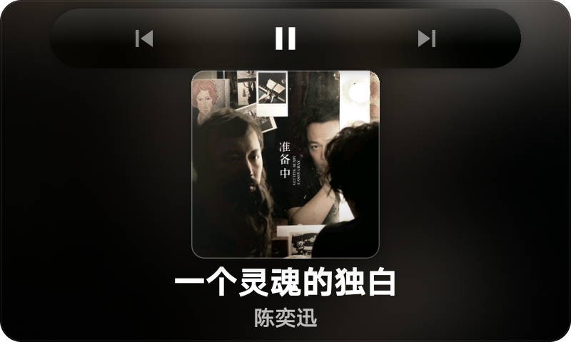
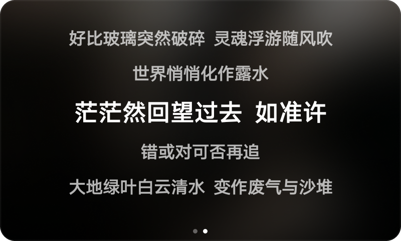
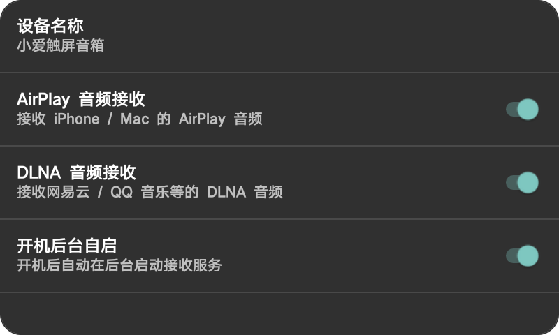

# LX04Cast

小爱触屏音箱（第一代）不支持 DLNA/AirPlay，于是写了一个只做音频投送的小工具。

它不做视频、不做屏幕镜像，只处理两件事：

- **AirPlay 1 音频接收**
- **DLNA / UPnP 音频接收**

界面按音箱横屏做了两页：播放页和歌词页。播放页是全屏模糊背景 + 大封面，点封面会浮出毛玻璃控制栏；左右滑动进入歌词页，歌词会跟随播放进度滚动。设置页保持系统原生的 Preference 列表，尽量少占内存。

## 小爱同学支持

- “小爱同学，暂停播放”
- “小爱同学，继续播放”
- “小爱同学，退出播放”
- 系统媒体键、媒体通知和播放页按钮同样可用
- 通过 MediaSession、媒体按钮和音频焦点兜底，尽量兼容 Mico 的语音媒体路由

> 不同 Mico 固件对第三方应用的语音媒体路由不同，实际响应以设备为准。

## 截图

| 播放页 | 控制栏 |
| --- | --- |
|  |  |

| 歌词页 | 设置页 |
| --- | --- |
|  |  |

## 项目地址

https://github.com/zoujiayu/LX04Cast

## 安装

从 [Releases](https://github.com/zoujiayu/LX04Cast/releases) 下载 `LX04Cast-0.1.10.apk`，或：

```bash
adb install -r LX04Cast-0.1.10.apk
```

当前 APK 使用 debug 证书签名，适合个人侧载。

## 构建

要求 JDK 17+、Android SDK 35、Gradle 8.11.1（仓库含 wrapper）：

```bash
./gradlew assembleRelease
```

预编译的 native 库已包含在 `app/src/main/jniLibs/armeabi-v7a/`。

## 说明

- 仅支持音频，不支持视频、图片和字幕。
- DLNA 的手机端音量和切歌队列由发送方 App 控制，接收端不能反向操作。
- 小爱语音在不同 Mico 固件上的路由不同；本项目已做 MediaSession、媒体按钮和音频焦点兜底，但不能保证所有固件。
- 不是小米官方项目。

## 来源与许可证

协议层基于 CastBay 1.9.0 和 UxPlay，项目以 **GPL-3.0-or-later** 开源。AriaCast 仅作产品形态参考，AirReceiverLite 仅做过协议分析，未复制其代码或 native 库。完整归属见 [NOTICE.md](NOTICE.md) 与 [LICENSE](LICENSE)。

欢迎试用、提 issue 或反馈兼容性。
